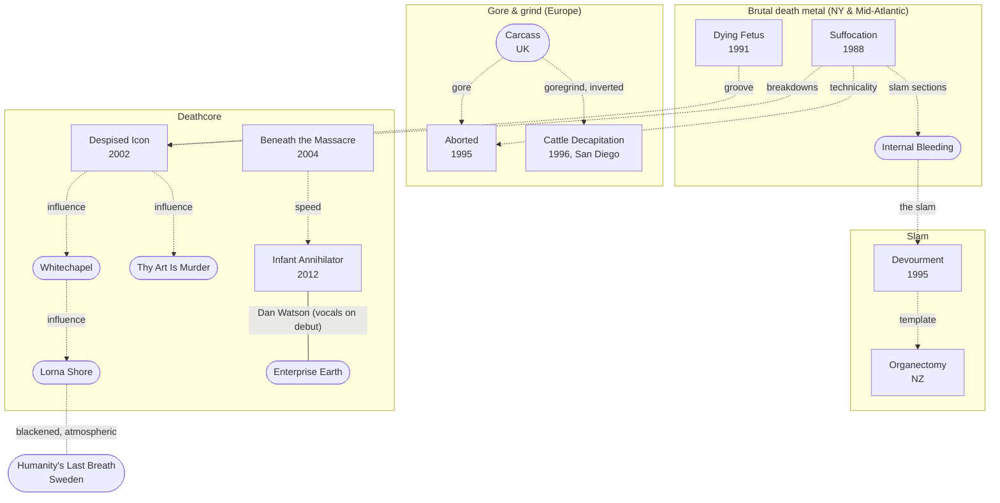

[← Brutal death](README.md)

# Connections

## Family tree
Solid lines are shared members. Dotted lines are influence. Rounded boxes are bands without a page here.

## Notes
- **Dan Watson** sang on Infant Annihilator's debut and went on to front Enterprise Earth.
- **Sven de Caluwé** is the only constant member of [Aborted](bands/aborted.md); the rest of the lineup has rotated constantly.
- [Despised Icon](../quebec/bands/despised-icon.md) and [Beneath the Massacre](../quebec/bands/beneath-the-massacre.md) are on the [Quebec](../quebec/README.md) pages.
