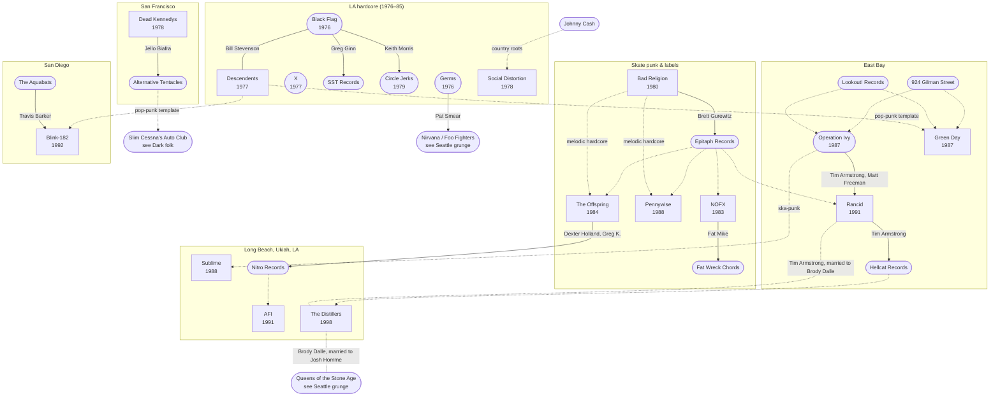

[← California punk](README.md)

# Connections

## Family tree
Solid lines are shared members or ownership. Dotted lines are influence or label releases.
Rounded boxes are bands, labels and venues without their own page.

## Brett Gurewitz
- [Bad Religion](bands/bad-religion.md): guitar, songwriter
- **Epitaph Records**: founder. Released [The Offspring](bands/the-offspring.md)'s *Smash*,
  [NOFX](bands/nofx.md), [Pennywise](bands/pennywise.md), [Rancid](bands/rancid.md) and many more

## Fat Mike
- [NOFX](bands/nofx.md): bass/vocals
- **Fat Wreck Chords**: co-founder (with Erin Burkett)
- Me First and the Gimme Gimmes (punk covers supergroup)

## Bill Stevenson
- Black Flag (drums), [Descendents](bands/descendents.md) (drums), ALL
- The Blasting Room studio (producer)

## Tim Armstrong and Matt Freeman
- Operation Ivy → [Rancid](bands/rancid.md)
- Armstrong: Hellcat Records, Transplants

## Pat Smear
- Germs → Nirvana (touring) → Foo Fighters. See [Seattle grunge](../seattle-grunge/connections.md)

## Travis Barker
- The Aquabats → [Blink-182](bands/blink-182.md) (from 1998); also Transplants, +44
