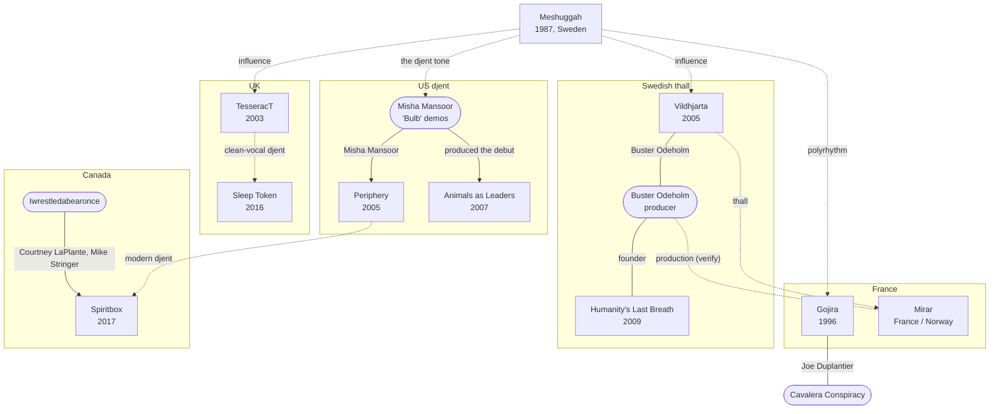

[← Djent & thall](README.md)

# Connections

## Family tree
Solid lines are shared members or production. Dotted lines are influence. Rounded boxes are
bands and people without a page in this section.

## Misha Mansoor
- [Periphery](bands/periphery.md): founder, guitar, producer
- Produced [Animals as Leaders](bands/animals-as-leaders.md)' debut; co-founded the gear company Horizon Devices

## Buster Odeholm
- [Humanity's Last Breath](../swedish-metal/bands/humanitys-last-breath.md), [Vildhjarta](../swedish-metal/bands/vildhjarta.md), production for [Mirar](bands/mirar.md) **(verify)**

## Courtney LaPlante and Mike Stringer
- Iwrestledabearonce → [Spiritbox](bands/spiritbox.md)

## Joe Duplantier
- [Gojira](bands/gojira.md): vocals/guitar
- Cavalera Conspiracy (bass on the first album)
