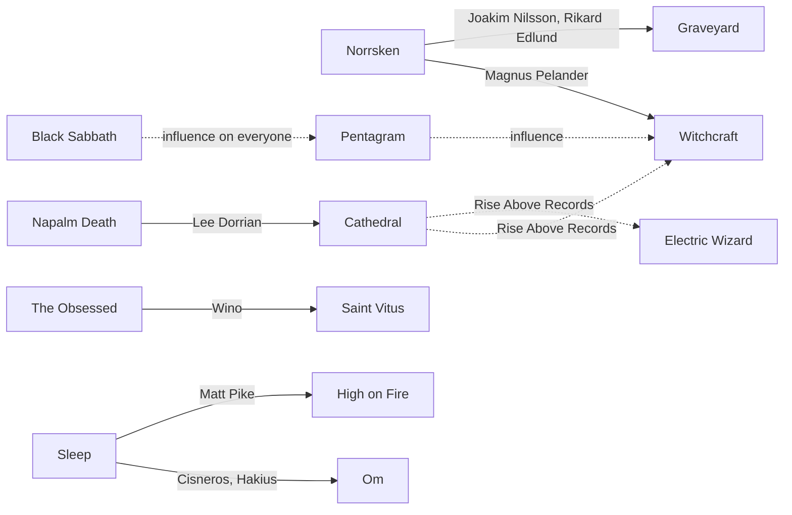

[← Doom](README.md)

# Connections

## Norrsken → Witchcraft and Graveyard
Norrsken was a late-90s Swedish retro rock band. When it ended:
- **Magnus Pelander** formed [Witchcraft](bands/witchcraft.md) (2000)
- **Joakim Nilsson** and **Rikard Edlund** later formed [Graveyard](bands/graveyard.md) (2006)
- Drummer Axel Sjöberg (Graveyard) was also involved **(verify)**

## Lee Dorrian and Rise Above Records
- Napalm Death (vocals on *Scum*) → [Cathedral](bands/cathedral.md)
- Founded **Rise Above Records**, which released [Witchcraft](bands/witchcraft.md)'s first albums,
  [Electric Wizard](bands/electric-wizard.md), Pentagram compilations, Blood Ceremony, Uncle Acid and more

## Scott "Wino" Weinrich
- The Obsessed → [Saint Vitus](bands/saint-vitus.md) → Spirit Caravan, The Hidden Hand, many more

## Victor Griffin
- [Pentagram](bands/pentagram.md) (guitar, on and off since the early 80s), Place of Skulls

## Sleep's split
- Al Cisneros and Chris Hakius → **Om**
- Matt Pike → **High on Fire**

