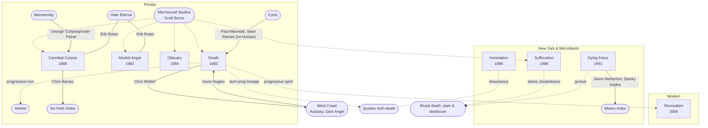

[← East Coast](README.md)

# Connections

## Family tree
Solid lines are shared members. Dotted lines are influence or a shared studio. Rounded
boxes are bands, studios and scenes without their own page here.

## Chuck Schuldiner
- [Death](bands/death.md): founder, guitar/vocals; the only constant
- Control Denied: a progressive/power metal project in his last years
- Died of brain cancer in December 2001

## Death's revolving lineup (a who's who of the genre)
- Chris Reifert (→ [Autopsy](../west-coast/bands/autopsy.md))
- Paul Masvidal and Sean Reinert (Cynic)
- Steve DiGiorgio (Sadus, Testament)
- Gene Hoglan (Dark Angel, Strapping Young Lad)
- Andy LaRocque (King Diamond)

## Erik Rutan
- [Morbid Angel](bands/morbid-angel.md) (guitar, late 90s), Hate Eternal (founder), [Cannibal Corpse](bands/cannibal-corpse.md) (guitar, since about 2019); also a prolific producer

## Chris Barnes
- [Cannibal Corpse](bands/cannibal-corpse.md) → Six Feet Under

## Jason Netherton
- [Dying Fetus](bands/dying-fetus.md) → Misery Index
