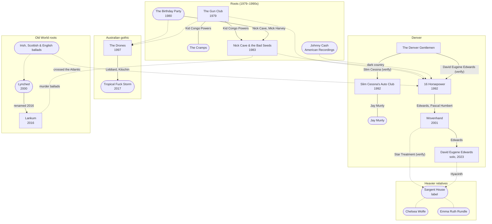

[← Gothic Americana](README.md)

# Connections

## Family tree
Solid lines are shared members. Dotted lines are influence or a label. Rounded boxes are
artists or labels without their own page.

## David Eugene Edwards
- [The Denver Gentlemen](bands/the-denver-gentlemen.md) **(verify)**
- [16 Horsepower](bands/16-horsepower.md): founder, vocals, banjo, bandoneon, guitar
- [Wovenhand](bands/wovenhand.md): founder
- [Solo](bands/david-eugene-edwards.md): *Hyacinth* (2023)

## Slim Cessna
- [The Denver Gentlemen](bands/the-denver-gentlemen.md) **(verify)**
- [Slim Cessna's Auto Club](bands/slim-cessnas-auto-club.md): founder

## Pascal Humbert (bass)
- Passion Fodder (France)
- [16 Horsepower](bands/16-horsepower.md)
- [Wovenhand](bands/wovenhand.md) (mid-2000s)
- Lilium

## Jay Munly
- [Slim Cessna's Auto Club](bands/slim-cessnas-auto-club.md)
- Solo / Munly & the Lee Lewis Harlots, Munly & the Lupercalians

## Kid Congo Powers (guitar)
- [The Gun Club](bands/the-gun-club.md)
- The Cramps
- [Nick Cave & the Bad Seeds](bands/nick-cave-and-the-bad-seeds.md) (late 80s)

## Gareth Liddiard and Fiona Kitschin
- [The Drones](bands/the-drones.md)
- Tropical Fuck Storm (from 2017)
- Liddiard solo: *Strange Tourist* (2010)

## Nick Cave
- The Boys Next Door → The Birthday Party → [Nick Cave & the Bad Seeds](bands/nick-cave-and-the-bad-seeds.md), Grinderman

