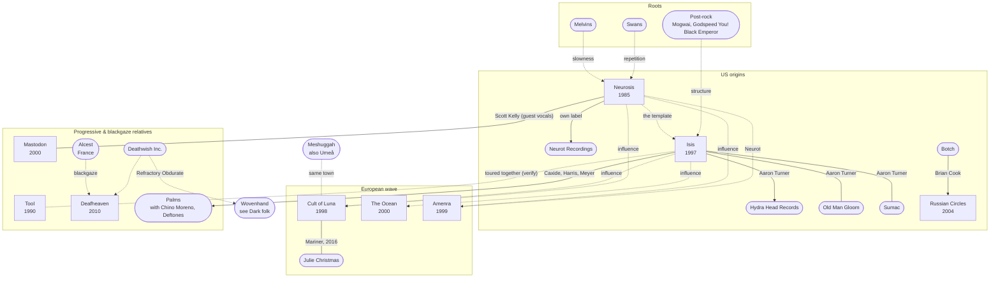

[← Post-metal](README.md)

# Connections

## Family tree
Solid lines are shared members or collaborations. Dotted lines are influence or a label.
Rounded boxes are bands and labels outside the main list.

## Aaron Turner
- [Isis](bands/isis.md): vocals/guitar, main visual artist
- Hydra Head Records: founder
- Old Man Gloom, Sumac, Mamiffer

## Brian Cook
- Botch, These Arms Are Snakes → [Russian Circles](bands/russian-circles.md) (bass)

## Julie Christmas
- Made of Bees and Battle of Mice; solo
- [Cult of Luna](bands/cult-of-luna.md): the collaborative album *Mariner* (2016)

## Neurot Recordings
- Neurosis' own label. Has released [Amenra](bands/amenra.md) **(verify)** and many others
