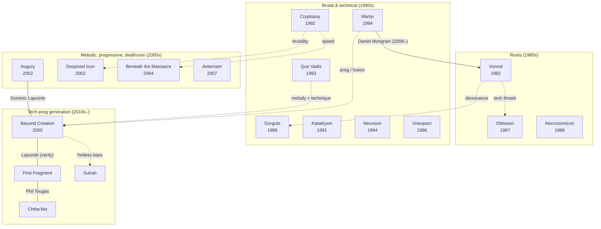

# Connections

The scene is small and the same players turn up in several bands.

## Family tree
Solid lines are shared members. Dotted lines are stylistic influence.

## Known links

## Dominic "Forest" Lapointe (fretless bass)
- [Beyond Creation](bands/beyond-creation.md): *The Aura*, *Earthborn Evolution*
- [Augury](bands/augury.md)
- [First Fragment](bands/first-fragment.md): bass on *Gloire Éternelle* **(verify)**
- Later replaced in Beyond Creation by **Hugo Doyon-Karout** (*Algorythm* onward)

## Phil Tougas (guitar)
- [First Fragment](bands/first-fragment.md): main songwriter
- [Chthe'ilist](bands/chtheilist.md)

## Daniel Mongrain (guitar)
- [Martyr](bands/martyr.md)
- [Voivod](bands/voivod.md): joined after Piggy (Denis D'Amour) died in 2005;
  in the band since 2008
- Also played live with Gorguts **(verify)**

## Flo Mounier (drums)
- [Cryptopsy](bands/cryptopsy.md): the constant through every lineup change

To add: map Kataklysm / Cryptopsy / Neuraxis member crossovers.
