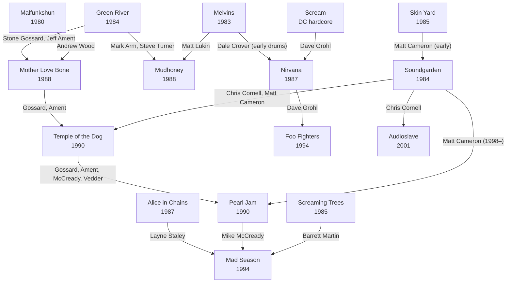

[← Seattle grunge](README.md)

# Connections: the Seattle Grunge Family Tree

Arrows show musicians moving from one band to another (or forming one). GitHub renders this
diagram automatically.

## The key people

| Person | Bands |
|--------|-------|
| **Stone Gossard** (guitar) | Green River → Mother Love Bone → Temple of the Dog → Pearl Jam; also Brad |
| **Jeff Ament** (bass) | Green River → Mother Love Bone → Temple of the Dog → Pearl Jam |
| **Mark Arm** (vocals) | Mr. Epp → Green River → Mudhoney |
| **Steve Turner** (guitar) | Green River → Mudhoney |
| **Andrew Wood** (vocals) | Malfunkshun → Mother Love Bone (d. 1990) |
| **Chris Cornell** (vocals) | Soundgarden → Temple of the Dog → Audioslave (d. 2017) |
| **Matt Cameron** (drums) | Skin Yard → Soundgarden → Temple of the Dog → Pearl Jam |
| **Mike McCready** (guitar) | Temple of the Dog → Pearl Jam → Mad Season |
| **Eddie Vedder** (vocals) | Bad Radio (San Diego) → Temple of the Dog (guest) → Pearl Jam |
| **Layne Staley** (vocals) | Alice in Chains → Mad Season (d. 2002) |
| **Matt Lukin** (bass) | Melvins → Mudhoney |
| **Dale Crover** (drums) | Melvins; drummed on Nirvana's first demo |
| **Dave Grohl** (drums) | Scream → Nirvana → Foo Fighters |
| **Barrett Martin** (drums) | Skin Yard → Screaming Trees → Mad Season |
| **Mark Lanegan** (vocals) | Screaming Trees → solo; guest on Mad Season's *Above* (d. 2022) |

## Two branches from one band
Green River's split in 1987–88 is the scene's central event:

- **The punk branch** (Arm, Turner) → Mudhoney: raw, fuzzy, sarcastic, and still on Sub Pop.
- **The rock branch** (Gossard, Ament) → Mother Love Bone → Pearl Jam: big classic-rock
  ambitions that led to stadium success.
