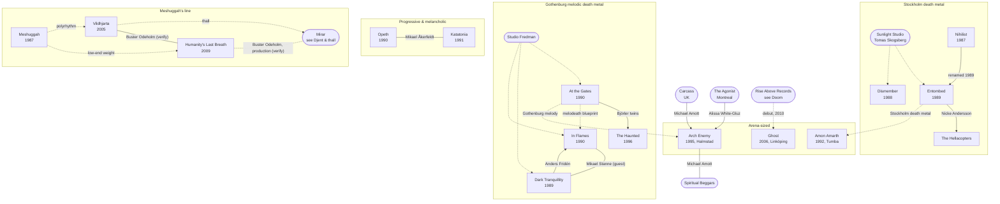

[← Swedish metal](README.md)

# Connections

## Family tree
Solid lines are shared members. Dotted lines are influence or a shared studio.

## Buster Odeholm
- [Humanity's Last Breath](bands/humanitys-last-breath.md): founder, guitar, production
- [Vildhjarta](bands/vildhjarta.md): member and producer **(verify exact role and years)**
- The main link between the two leading thall bands
- [Mirar](../djent-thall/bands/mirar.md): reportedly involved in mixing/mastering **(verify)**

## Mikael Stanne
- [Dark Tranquillity](bands/dark-tranquillity.md): vocals (originally rhythm guitar)
- [In Flames](bands/in-flames.md): guest vocals on the debut *Lunar Strain* (1994)

## Mikael Åkerfeldt
- [Opeth](bands/opeth.md): leader
- [Katatonia](bands/katatonia.md): harsh vocals on *Brave Murder Day* (1996)
- Storm Corrosion, with Steven Wilson

## Anders and Jonas Björler
- [At the Gates](bands/at-the-gates.md)
- The Haunted, formed after At the Gates split in 1996

## Nicke Andersson
- [Entombed](bands/entombed.md): drums (and vocals on *Clandestine*)
- The Hellacopters (garage rock)

## Jesper Strömblad
- [In Flames](bands/in-flames.md): founder
- Dimension Zero, HammerFall (early)

