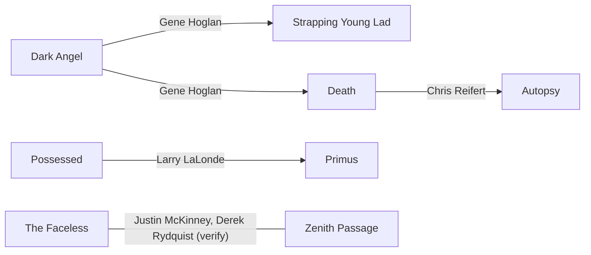

[← West Coast](README.md)

# Connections

## Gene Hoglan (drums)
- Dark Angel (Los Angeles)
- Death (on *Individual Thought Patterns* and *Symbolic*)
- [Strapping Young Lad](bands/strapping-young-lad.md)
- Later Testament and many others

## Chris Reifert (drums, vocals)
- Death: drums on *Scream Bloody Gore* (1987)
- [Autopsy](bands/autopsy.md): founder

## Larry LaLonde (guitar)
- [Possessed](bands/possessed.md)
- Later Primus

## Justin McKinney (guitar)
- [Zenith Passage](bands/zenith-passage.md): founder
- [The Faceless](bands/the-faceless.md): touring/recording guitarist **(verify)**

## Derek Rydquist (vocals)
- [The Faceless](bands/the-faceless.md)
- [Zenith Passage](bands/zenith-passage.md) **(verify)**

## Devin Townsend
- [Strapping Young Lad](bands/strapping-young-lad.md)
- Steve Vai's band (vocals on *Sex & Religion*, 1993)
- A large solo catalogue

## Across scenes
Archspire, Beyond Creation, First Fragment and Zenith Passage are all part of the same
2010s tech-death circuit and often tour together. See [Quebec](../quebec/README.md).
